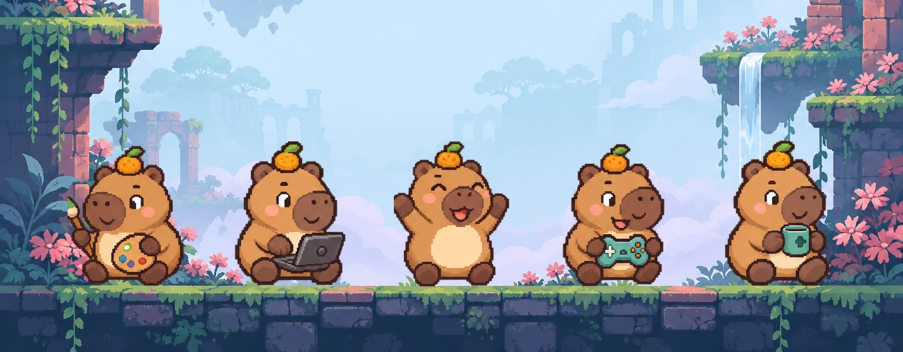
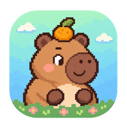
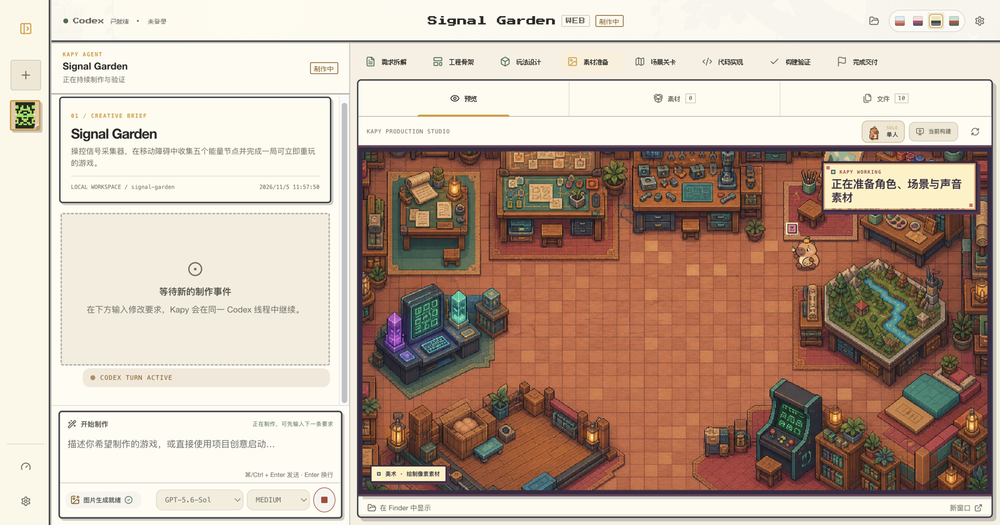
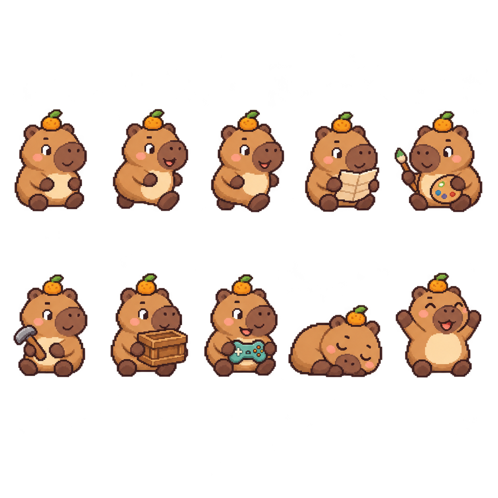
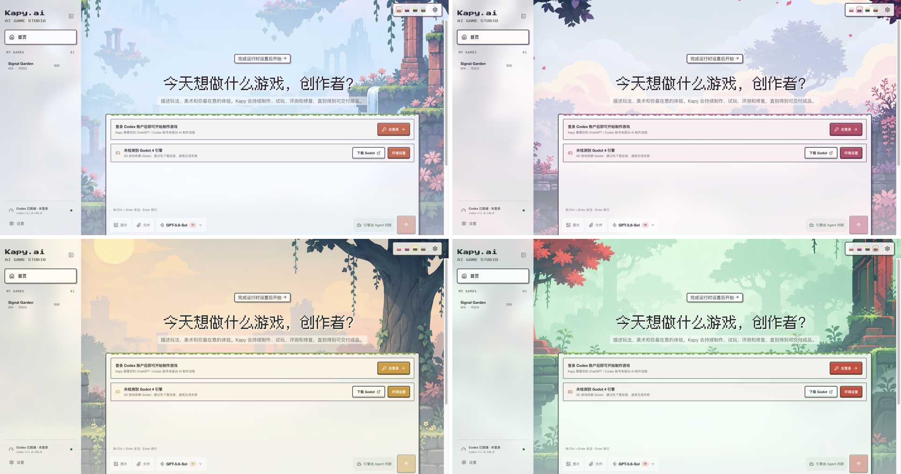
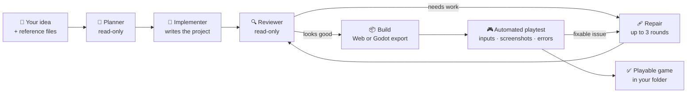
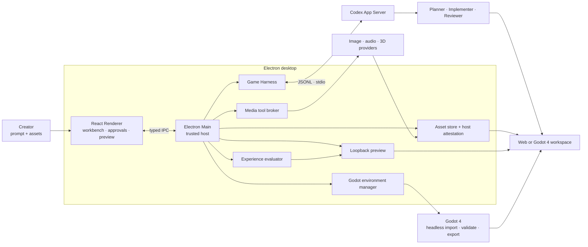

<p align="center">
  
</p>

<h1 align="center">
  &nbsp;Kapy.ai
</h1>

<p align="center">
  <strong>GameHarness · Describe a game in one sentence. Get a reviewed, playable game back.</strong><br>
  <sub>A local-first desktop game studio where a pixel capybara and a team of AI agents plan, build, review and playtest your idea — as a real Web or Godot 4 project you own.</sub>
</p>

<p align="center">
  <a href="LICENSE"></a>
  
  
  
  
  
</p>

<p align="center">
  <a href="#-quick-start"><strong>Quick start</strong></a> ·
  <a href="#-how-it-works"><strong>How it works</strong></a> ·
  <a href="#-meet-kapy"><strong>Meet Kapy</strong></a> ·
  <a href="#-make-it-yours"><strong>Make it yours</strong></a> ·
  <a href="README.zh-CN.md"><strong>简体中文</strong></a>
</p>

<br>



## ✨ Why Kapy.ai

Most AI coding tools hand one agent a prompt and hope for the best. Kapy.ai runs your idea through a small, disciplined studio instead — and refuses to call a game "done" until it has actually been built and played.

<table>
  <tr>
    <td width="33%" valign="top">
      <h3>💬 Prompt → playable</h3>
      Write one sentence, drop in reference images if you like. Kapy picks Web or Godot 4, scaffolds a real project and keeps going until you can play it in the built-in preview.
    </td>
    <td width="33%" valign="top">
      <h3>🧑‍🤝‍🧑 A studio, not a single bot</h3>
      A read-only <b>Planner</b> scopes the work, an <b>Implementer</b> builds, an independent <b>Reviewer</b> checks every claim against the real files. Failed checks trigger up to three repair rounds.
    </td>
    <td width="33%" valign="top">
      <h3>🎮 It actually plays the game</h3>
      A hidden browser launches the production build, presses the real controls, records screenshots and errors, and scores loading, feedback, animation and restart before delivery.
    </td>
  </tr>
  <tr>
    <td valign="top">
      <h3>🎨 Real art, sound and 3D</h3>
      Images, music, voice, sound effects and GLB models flow through your own providers, Codex ImageGen or procedural fallbacks — tracked as asset work orders you can retry.
    </td>
    <td valign="top">
      <h3>📁 You own every file</h3>
      Each game is a normal folder on your disk. Open it, commit it, keep iterating with Codex, or take it anywhere. Nothing is locked inside the app.
    </td>
    <td valign="top">
      <h3>🦫 Delightful to watch</h3>
      Kapy and friends walk around a pixel studio while the agents work, and four hand-painted scene skins let you choose the mood of your workspace.
    </td>
  </tr>
</table>

## 🦫 Meet Kapy

Kapy is a calm, chubby pixel capybara with a yuzu on its head — and your production partner. While the agents run, Kapy paints sprites, hammers at the build, types code, inspects the result and celebrates when the playtest passes.

<p align="center">
  
</p>

Pick the world you work in. Four pixel scene skins retint the whole interface — panels, buttons, frames and backgrounds:



| 🌤 Sky Ruins | 🌸 Blossom Bridge | 🌅 Dusk Wall | 🌿 Jade Grove |
| :---: | :---: | :---: | :---: |
| Pale-blue mist, terracotta ruins, coral blossoms | Cream clouds, violet stone, magenta leaves | Butter-yellow sky, grey walls, deep-green canopy | Mint fog, mossy bridge, vermilion maple |

## 🚀 Quick start

**You will need**

- macOS
- [Node.js 22 LTS](https://nodejs.org/) and npm
- a ChatGPT / Codex account
- *(only if Kapy chooses Godot)* [Godot 4](https://godotengine.org/) with the exactly matching Web export templates

```bash
git clone https://github.com/nepheloovo/Kapy.ai.git
cd Kapy.ai
npm ci
npm run dev
```

On first launch, open **Settings → Codex account** and sign in. Kapy.ai keeps its own private Codex home and never touches your global `~/.codex` configuration.

> [!NOTE]
> Kapy.ai is a **developer preview**. There is no signed, notarized download yet — run it from source. Every game it makes is a standalone Web or Godot 4 project in your own workspace.

<details>
<summary><b>Codex not found?</b></summary>

Point Kapy.ai at a Codex binary explicitly:

```bash
KAPY_CODEX_BIN=/absolute/path/to/codex npm run dev
```

</details>

## 🧠 How it works



The workbench shows eight stages — **Brief → Scaffold → GDD → Assets → World → Code → Verify → Complete** — so you always know what the studio is doing. A run is only marked complete when both the Reviewer and the host's own build-and-playtest checks pass; account, quota or permission problems pause the run so you can resume it instead of receiving a half-finished game.

<details>
<summary><b>Architecture at a glance</b></summary>



Read the full [architecture guide](docs/ARCHITECTURE.md) and [product capability map](docs/PRODUCT_FUNCTIONS.md).

</details>

<details>
<summary><b>What's inside</b></summary>

**Production workbench**

- eight visible production stages and a live agent event stream
- command and file-change approvals
- playable loopback preview, project file browser and a unified asset library
- Web or Godot 4 workspaces chosen by the agent, with environment and export-template checks
- Kapy crew characters, role-based motion, selectable studios and an animated pond scene
- persistent projects and resumable Codex threads

**Media and extensions**

- configurable image, audio and 3D REST providers, with Codex ImageGen as the image fallback
- music, speech, vocal effects, procedural WAV and Web Audio paths
- self-contained GLB generation with a procedural Three.js fallback
- image and file attachments that guide planning, art direction and asset reuse
- retryable asset work orders that keep placeholders visible after a failed generation
- native Codex Skills, stdio / HTTP MCP servers and per-role prompt customization

**Trust boundaries**

- sandboxed Electron renderer with typed IPC only
- API keys sealed with Electron `safeStorage` and never sent back to the renderer
- preview server bound to `127.0.0.1` only
- path, symlink, MIME, size, SHA-256 and production-reference checks on every generated asset

</details>

## 🧩 Make it yours

Kapy.ai is built around replaceable pieces, so a useful fork can start small:

| I want to… | Start here |
| --- | --- |
| add or swap a media provider | [`mediaProviderStore.ts`](src/main/mediaProviderStore.ts) · [`mediaGenerationService.ts`](src/main/mediaGenerationService.ts) |
| connect a tool or internal service through MCP | [`mcpConfigManager.ts`](src/main/mcpConfigManager.ts) |
| change how the Planner, Implementer, Reviewer or Repair behave | [`promptTemplateStore.ts`](src/main/promptTemplateStore.ts) · [`gameHarness.ts`](src/main/gameHarness.ts) |
| change the game scaffold and project rules | [`workspaceTemplate.ts`](src/main/workspaceTemplate.ts) |
| redesign the workbench | [`src/renderer/components`](src/renderer/components) |
| add a host-side dynamic tool | [`mediaToolBroker.ts`](src/main/mediaToolBroker.ts) |

<details>
<summary><b>Development commands</b></summary>

```bash
npm run typecheck       # renderer + main process
npm test                # unit and integration tests
npm run build           # production bundles
npm run verify          # typecheck + tests + build
npm run smoke:ui        # isolated Electron UI screenshot
```

These smoke tests use a signed-in Codex account and may spend a little Codex or media-provider quota:

```bash
npm run smoke:codex
npm run smoke:harness
npm run smoke:media
npm run smoke:image
npm run smoke:model3d
npm run smoke:godot
npm run smoke:playtest
```

Build an unsigned macOS DMG locally with `npm run package:mac`. Public distribution still needs Developer ID signing, notarization and stapling.

</details>

<details>
<summary><b>Current limits</b></summary>

- Web and Godot 4 / GDScript projects are supported. Godot delivery currently targets a Compatibility-renderer Web export; native macOS, Windows and Linux exports are not wired up yet.
- macOS is the only release target today. Windows and Linux are on the roadmap.
- Meshy, Tripo and Rodin use a synchronous REST gateway rather than each vendor's native async jobs.
- The built-in Three.js fallback makes functional low-poly GLB models, not provider-grade organic topology or textures.
- Quality depends on the model, the prompt, your dependencies and the media routes you configure. A run that cannot pass the checks stays blocked instead of being presented as finished.

</details>

## 🗺 Roadmap & contributing

Signed macOS builds, Windows and Linux support, more game templates, run comparison and a gallery of generated games are next — see the [roadmap](ROADMAP.md).

Contributions that make the pipeline safer, more portable or easier to extend are very welcome. Read [`CONTRIBUTING.md`](CONTRIBUTING.md), run `npm run verify`, and open a focused pull request. Please report security issues privately as described in [`SECURITY.md`](SECURITY.md).

## 📄 License

Kapy.ai is released under the [MIT License](LICENSE).

The bundled Twilight Sparkle and Hello Kitty character packs depict characters whose names and likenesses belong to their respective rights holders. They are not covered by the MIT License and are included for personal, non-commercial use only.

<p align="center"><sub>Made with 🍊 by <a href="https://github.com/nepheloovo">nepheloovo</a> and a very patient capybara.</sub></p>
