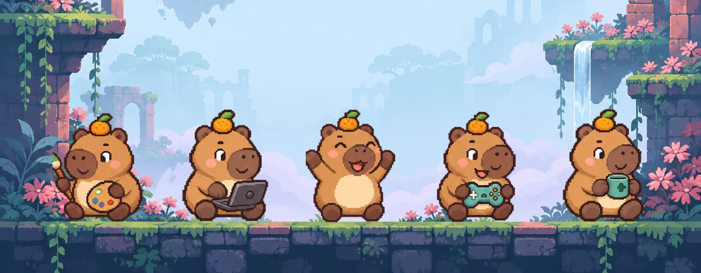
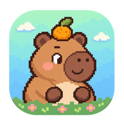
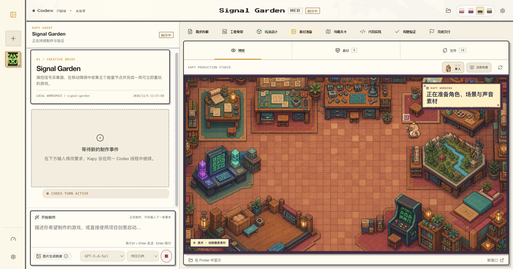
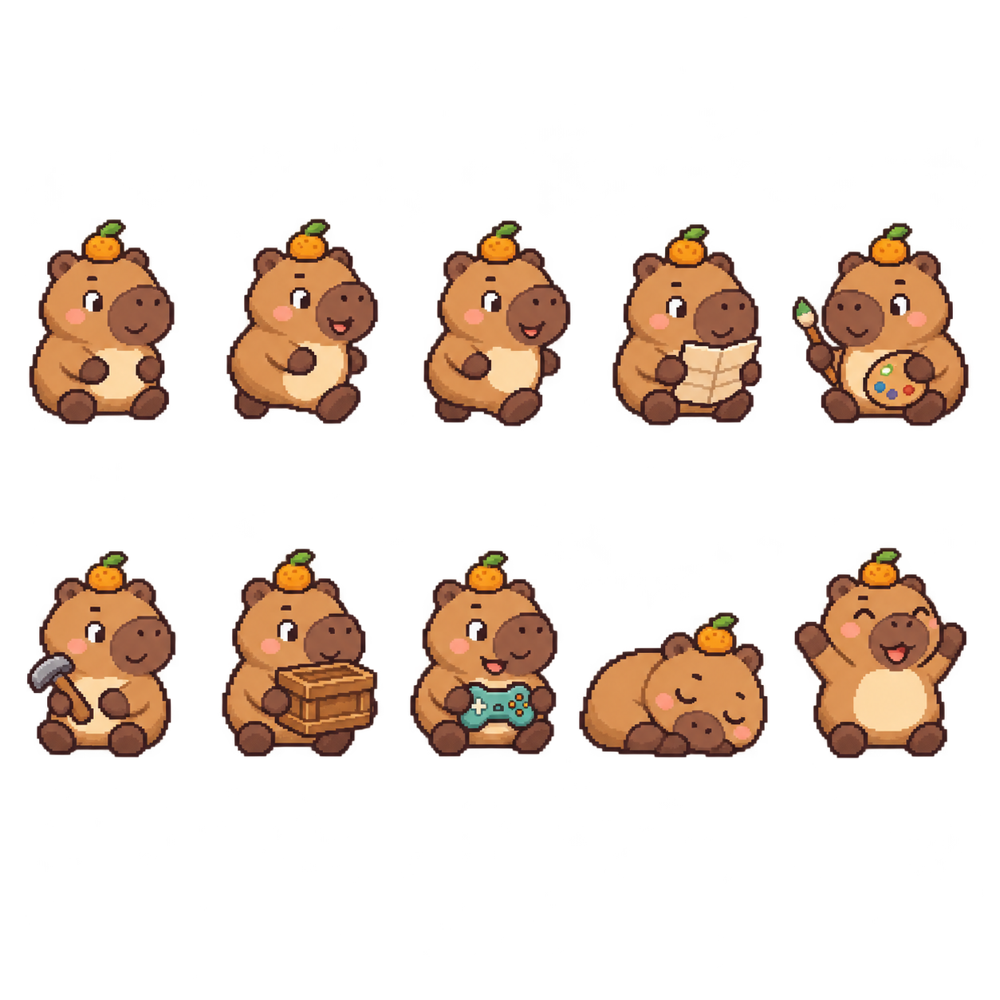
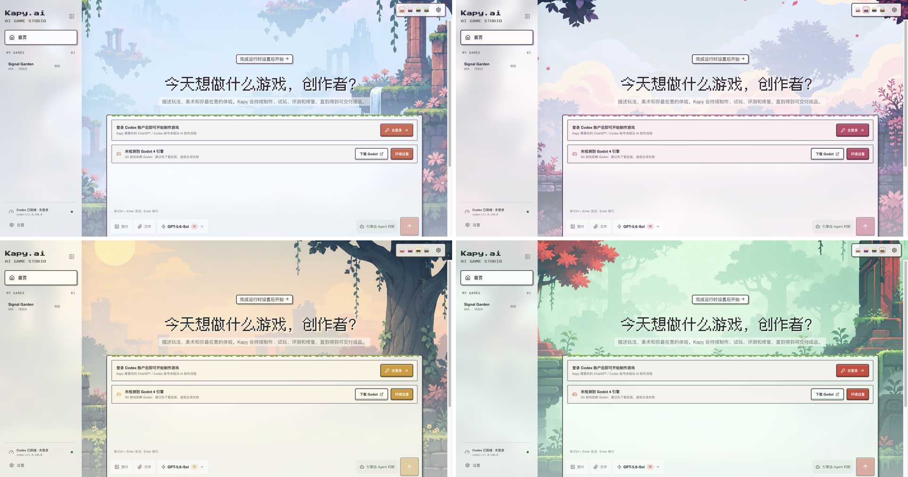
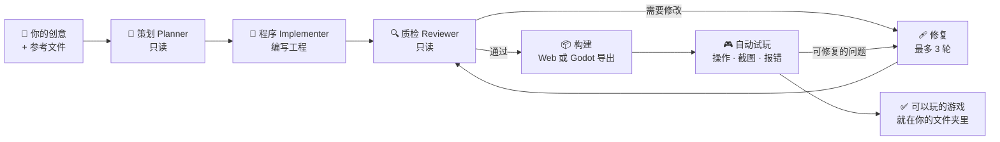
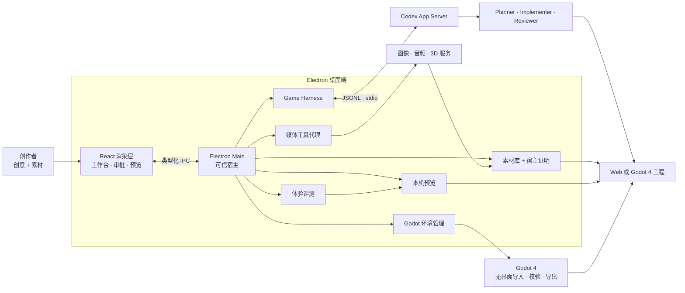

<p align="center">
  
</p>

<h1 align="center">
  &nbsp;Kapy.ai
</h1>

<p align="center">
  <strong>GameHarness · 一句话描述游戏，拿回一款经过审查、可以直接玩的游戏。</strong><br>
  <sub>一个本地优先的桌面游戏工作室：一只像素卡皮巴拉带着一队 AI Agent，替你策划、制作、审查并试玩，最终交付一个完全属于你的 Web 或 Godot 4 游戏工程。</sub>
</p>

<p align="center">
  <a href="LICENSE"></a>
  
  
  
  
  
</p>

<p align="center">
  <a href="#-快速开始"><strong>快速开始</strong></a> ·
  <a href="#-工作原理"><strong>工作原理</strong></a> ·
  <a href="#-认识-kapy"><strong>认识 Kapy</strong></a> ·
  <a href="#-按你的需要改造"><strong>二次开发</strong></a> ·
  <a href="README.md"><strong>English</strong></a>
</p>

<br>



## ✨ 为什么是 Kapy.ai

大多数 AI 编程工具把需求丢给一个 Agent，然后听天由命。Kapy.ai 把你的创意交给一个分工明确、讲规矩的小工作室，并且**没有真正构建、真正试玩过，就绝不说"做完了"**。

<table>
  <tr>
    <td width="33%" valign="top">
      <h3>💬 一句话 → 能玩</h3>
      写一句创意，愿意的话再拖几张参考图。Kapy 会自己判断用 Web 还是 Godot 4，搭好真实工程，一直做到你能在内置预览里直接上手玩。
    </td>
    <td width="33%" valign="top">
      <h3>🧑‍🤝‍🧑 一个工作室，而不是一个机器人</h3>
      只读的<b>策划</b>拆解任务，<b>程序</b>动手实现，独立的<b>质检</b>对照真实文件逐条核查。没通过就退回修复，最多三轮。
    </td>
    <td width="33%" valign="top">
      <h3>🎮 它真的会去玩</h3>
      隐藏浏览器会打开正式构建，按下真实的操作键，记录截图和报错，从加载、操作反馈、动画到重新开始逐项打分，合格才交付。
    </td>
  </tr>
  <tr>
    <td valign="top">
      <h3>🎨 真实的美术、音效和 3D</h3>
      图片、音乐、配音、音效和 GLB 模型可以走你自己的服务商、Codex ImageGen 或程序化生成；每个素材都有工单，失败了可以单独重试。
    </td>
    <td valign="top">
      <h3>📁 每个文件都归你</h3>
      每个游戏都是你电脑上的普通文件夹。打开、提交到 Git、继续用 Codex 改，或者带到任何地方，都不会被锁在应用里。
    </td>
    <td valign="top">
      <h3>🦫 看着就开心</h3>
      Agent 干活时，Kapy 和伙伴们会在像素工坊里走来走去；四套手绘场景皮肤，让你挑选喜欢的工作氛围。
    </td>
  </tr>
</table>

## 🦫 认识 Kapy

Kapy 是一只头顶柚子、圆滚滚、慢悠悠的像素卡皮巴拉，也是你的制作搭档。Agent 工作时，Kapy 会画素材、敲敲打打修构建、埋头写代码、拿放大镜检查结果，试玩通过时还会举手欢呼。

<p align="center">
  
</p>

选一个你喜欢的世界。四套像素场景皮肤会给整个界面换装——面板、按钮、边框和背景都会跟着变：



| 🌤 天空遗迹 | 🌸 花影石桥 | 🌅 暮光古墙 | 🌿 翡翠秘林 |
| :---: | :---: | :---: | :---: |
| 浅蓝薄雾、砖红遗迹、珊瑚色花藤 | 奶油云朵、紫灰石砖、玫红树叶 | 奶黄天空、灰色石墙、墨绿树冠 | 薄荷雾气、苔绿石桥、朱红枫树 |

## 🚀 快速开始

**你需要准备**

- macOS
- [Node.js 22 LTS](https://nodejs.org/) 和 npm
- 一个 ChatGPT / Codex 账号
- *（仅当 Kapy 选择 Godot 时）* [Godot 4](https://godotengine.org/) 以及版本完全匹配的 Web 导出模板

```bash
git clone https://github.com/nepheloovo/Kapy.ai.git
cd Kapy.ai
npm ci
npm run dev
```

首次启动后，打开 **设置 → Codex 账户** 登录即可。Kapy.ai 使用自己独立的 Codex 目录，不会改动你全局的 `~/.codex` 配置。

> [!NOTE]
> Kapy.ai 目前是**开发者预览版**，还没有签名、公证过的安装包，请从源码运行。它做出的每个游戏，都是你工作区里一个独立的 Web 或 Godot 4 工程。

<details>
<summary><b>找不到 Codex？</b></summary>

手动指定 Codex 可执行文件的位置：

```bash
KAPY_CODEX_BIN=/absolute/path/to/codex npm run dev
```

</details>

## 🧠 工作原理



工作台会显示八个阶段——**需求 → 搭建 → 策划案 → 素材 → 场景 → 代码 → 验证 → 完成**——让你随时知道工作室在忙什么。只有质检和系统自己的构建、试玩检查都通过，才会标记为完成；如果遇到账号、额度或权限问题，制作会暂停等待，你处理好后可以继续，而不会拿到一个半成品。

<details>
<summary><b>技术架构一览</b></summary>



完整说明见[架构文档](docs/ARCHITECTURE.md)和[功能拆解](docs/PRODUCT_FUNCTIONS.md)。

</details>

<details>
<summary><b>都有哪些能力</b></summary>

**制作工作台**

- 八个可视化制作阶段和实时 Agent 事件流
- 命令执行与文件修改审批
- 可直接游玩的本机预览、工程文件浏览和统一素材库
- 由 Agent 选择 Web 或 Godot 4 工程，并检查运行环境与导出模板
- Kapy 角色编队、按岗位变化的动作、可切换的工作室，以及会动的荷塘钓鱼场景
- 项目持久保存，Codex 会话可恢复继续

**媒体与扩展**

- 可配置的图像、音频和 3D 服务，图片可回退到 Codex ImageGen
- 音乐、配音、人声音效、程序化 WAV 与 Web Audio
- 自包含 GLB 模型生成，未配置服务时用 Three.js 程序化兜底
- 图片和文件附件会影响策划、美术方向和素材复用
- 素材工单可重试，生成失败也会保留占位
- 原生 Codex Skills、stdio / HTTP MCP 服务，以及按角色定制提示词

**安全边界**

- 沙箱化的 Electron 渲染层，只通过类型化 IPC 通信
- API 密钥用 Electron `safeStorage` 加密，保存后不会再回传给界面
- 预览服务只监听 `127.0.0.1`
- 每个生成素材都会校验路径、符号链接、类型、大小、SHA-256 以及是否真正被游戏引用

</details>

## 🧩 按你的需要改造

Kapy.ai 由一个个可替换的模块组成，二次开发可以从很小的地方开始：

| 我想要… | 从这里开始 |
| --- | --- |
| 新增或更换媒体服务商 | [`mediaProviderStore.ts`](src/main/mediaProviderStore.ts) · [`mediaGenerationService.ts`](src/main/mediaGenerationService.ts) |
| 通过 MCP 接入工具或内部服务 | [`mcpConfigManager.ts`](src/main/mcpConfigManager.ts) |
| 调整策划、程序、质检或修复的行为 | [`promptTemplateStore.ts`](src/main/promptTemplateStore.ts) · [`gameHarness.ts`](src/main/gameHarness.ts) |
| 修改游戏工程模板和项目规则 | [`workspaceTemplate.ts`](src/main/workspaceTemplate.ts) |
| 重新设计工作台界面 | [`src/renderer/components`](src/renderer/components) |
| 新增宿主侧动态工具 | [`mediaToolBroker.ts`](src/main/mediaToolBroker.ts) |

<details>
<summary><b>开发命令</b></summary>

```bash
npm run typecheck       # 渲染层 + 主进程类型检查
npm test                # 单元与集成测试
npm run build           # 生产构建
npm run verify          # 类型检查 + 测试 + 构建
npm run smoke:ui        # 隔离环境下的 Electron 界面截图
```

以下冒烟测试需要已登录的 Codex 账号，可能会消耗少量 Codex 或媒体服务额度：

```bash
npm run smoke:codex
npm run smoke:harness
npm run smoke:media
npm run smoke:image
npm run smoke:model3d
npm run smoke:godot
npm run smoke:playtest
```

本地打一个未签名的 macOS 安装包：`npm run package:mac`。正式公开分发仍需要 Developer ID 签名、Apple 公证和 stapling。

</details>

<details>
<summary><b>当前限制</b></summary>

- 支持 Web 与 Godot 4 / GDScript 工程。Godot 目前交付的是 Compatibility 渲染器的 Web 导出，原生 macOS、Windows、Linux 导出还未接入。
- 目前只发布 macOS 版本，Windows 和 Linux 在路线图中。
- Meshy、Tripo、Rodin 目前通过同步 REST 网关接入，尚未对接各家原生的异步任务。
- 内置的 Three.js 兜底只能生成可用的低多边形 GLB 模型，达不到专业服务商的有机拓扑与贴图质量。
- 最终质量取决于所选模型、提示词、依赖环境和你配置的媒体服务。无法通过检查的制作会停在阻塞状态，而不会被当作完成交付。

</details>

## 🗺 路线图与参与贡献

签名版 macOS 安装包、Windows 与 Linux 支持、更多游戏模板、制作结果对比，以及生成游戏作品集，都在计划中——详见[路线图](ROADMAP.md)。

非常欢迎让管线更安全、更易移植、更容易扩展的贡献。请先阅读 [`CONTRIBUTING.md`](CONTRIBUTING.md)，运行 `npm run verify`，再提交范围清晰的 Pull Request。安全问题请按 [`SECURITY.md`](SECURITY.md) 私下报告。

## 📄 许可证

Kapy.ai 以 [MIT 许可证](LICENSE)发布。

内置的暮光闪闪与 Hello Kitty 角色包所描绘的角色，其名称与形象归各自权利方所有，不在 MIT 许可证授权范围内，仅供个人非商业使用。

<p align="center"><sub>由 <a href="https://github.com/nepheloovo">nepheloovo</a> 和一只非常有耐心的卡皮巴拉用 🍊 制作。</sub></p>
